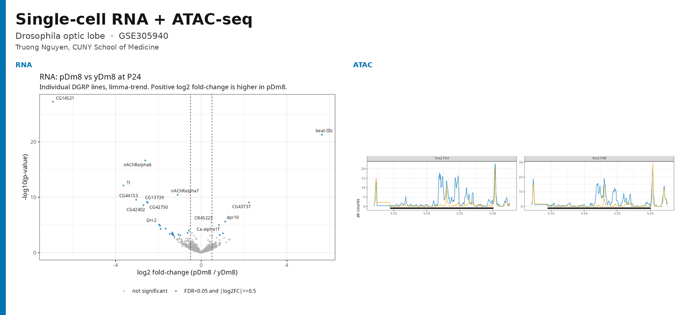

# Single-cell RNA + ATAC-seq



**Truong Nguyen**  
CUNY School of Medicine

Single-nucleus RNA and ATAC of the developing *Drosophila melanogaster* optic lobe. Inside the published Dm8 population, beat-IIIc and DIP-gamma mark pale (pDm8) and yellow (yDm8) cells. This repository tests which other genes, and which chromatin regions, differ between those two groups.

## Data

| Accession | Role |
|---|---|
| [GSE305940](https://www.ncbi.nlm.nih.gov/geo/query/acc.cgi?acc=GSE305940) | Primary 10x multiome: RNA and ATAC |
| [GSE156455](https://www.ncbi.nlm.nih.gov/geo/query/acc.cgi?acc=GSE156455) | Independent optic-lobe scRNA-seq, used only to check expression |

Sequence files and count objects are not in this repository.

## Result

At 24 h and 48 h after puparium formation, three genes stay higher in yDm8 across the models that were fit: **nAChRalpha6**, **CG44153**, and **Tl**. Six ATAC peaks inside **Vsx2** are more open in pDm8 at both stages. Peak–gene links are candidates, not demonstrated enhancers.

The comparison is in [ANALYSIS.md](ANALYSIS.md). Figures are in `figures/`. Tables are in `results/`.

## Layout

```
figures/     plots, including the overview image
results/     differential tables and summaries
scripts/     R and Python analysis scripts
igv/         dm6 tracks for the same results
```

Scripts look for the project directory from their own location. Count files, if you download them from GEO, belong in `data/` and are ignored by git.
